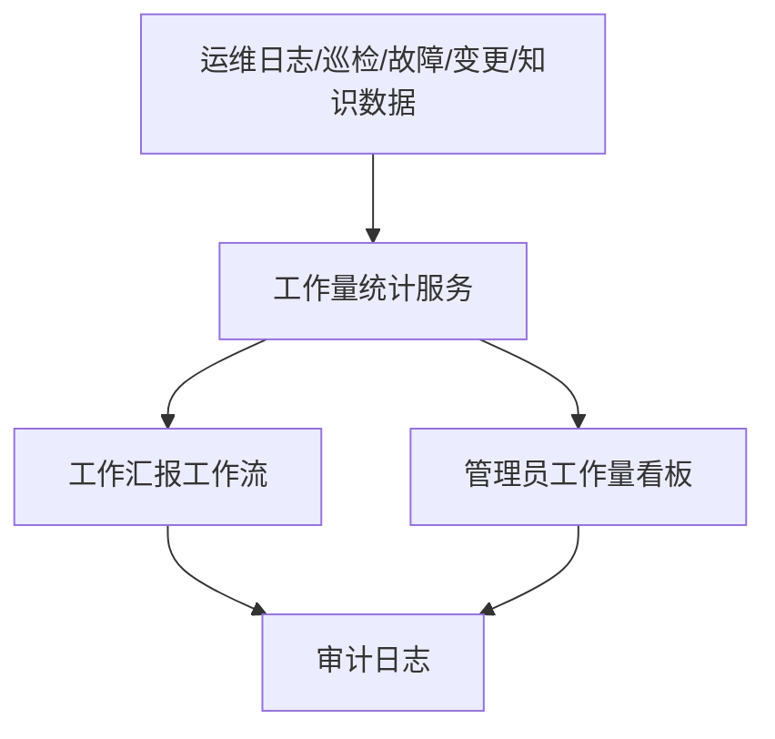

# 工作汇报第一阶段设计

Feature Name: work-report-phase-1
Updated: 2026-08-19

## Description

第一阶段在现有报表模块内新增三块能力：
1. 运维人员独立提交日报、周报、月报。
2. 管理员审核、退回、锁定工作汇报。
3. 管理员按日、周、月和自定义时间范围查看人员工作量看板。

## Architecture



## Components and Interfaces

- `server.js`
  - 扩展 `dbCollectionKeys`，新增 `workReports`
  - 扩展 `normalizeDb()`，统一工作汇报数据结构
  - 新增工作量统计辅助函数，统一周期范围与指标口径
  - 新增工作汇报 CRUD、提交、审核、锁定和导出接口
- `public/index.html`
  - 扩展 `state`，增加 `workReports` 与报表过滤状态
  - 将报表页改为“工作量看板 / 工作汇报 / 汇报审核”三块界面
  - 新增工作汇报表单、列表、审核列表与 CSV 导出入口

## Data Models

### workReports

```text
id: string
reportType: daily | weekly | monthly
projectId: string
userId: string
periodKey: string
rangeStart: string
rangeEnd: string
status: draft | submitted | returned | approved | locked
summary: string
completedWork: string
pendingWork: string
risks: string
nextPlan: string
metricsSnapshot:
  logCount: number
  totalHours: number
  inspectionCount: number
  incidentCount: number
  changeCount: number
  knowledgeCount: number
submittedAt: string
reviewedAt: string
reviewedBy: string
reviewComment: string
lockedAt: string
createdAt: string
updatedAt: string
```

## Correctness Properties

- 同一用户、同一项目、同一汇报类型、同一周期只允许存在一条工作汇报。
- 已锁定工作汇报只允许管理员查看，不允许再次编辑。
- 自动汇总指标必须始终通过统一统计函数生成。
- 工作量看板与工作汇报快照必须共享相同统计口径。

## Error Handling

- 非管理员访问审核接口时返回 `403`。
- 工程师尝试操作其他项目工作汇报时返回 `403`。
- 自定义时间范围缺少开始或结束日期时返回 `400`。
- 已锁定工作汇报再次编辑时返回 `400`。

## Test Strategy

- 后端：覆盖工作汇报创建、提交、退回、确认、锁定、看板汇总和 CSV 导出。
- 前端：覆盖报表页切换、每日/周/月/自定义时间范围切换、工作汇报提交与管理员审核流程。
- 回归：验证现有 `smoke`、`regression` 保持通过，并补充第一阶段新能力的最小自动化路径。
