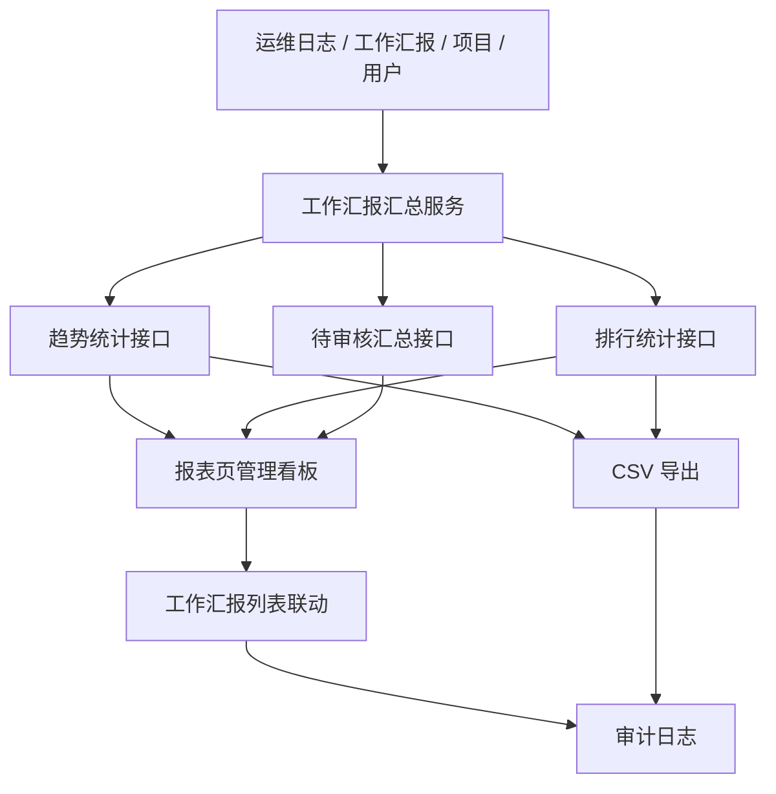

# 工作汇报第二阶段设计

Feature Name: work-report-phase-2
Updated: 2026-08-19

## Description

第二阶段在第一阶段“工作汇报与工作量看板”的基础上，面向管理员新增趋势与汇总能力。实现重点包括：跨周期趋势统计、人员与项目排行、待审核汇总，以及工作汇报明细和汇总结果导出。

## Architecture



## Components and Interfaces

- `server.js`
  - 在现有工作量统计能力上新增工作汇报汇总函数。
  - 新增趋势、排行、待审核汇总和导出接口。
  - 复用现有权限控制与审计日志写入。
- `public/index.html`
  - 在报表页增加“管理汇总看板”区域。
  - 增加统计口径、时间范围、项目筛选与导出入口。
  - 支持从待审核汇总点击后联动工作汇报列表筛选。
- `scripts/regression.js`
  - 覆盖趋势、排行、待审核汇总和导出接口。
- `scripts/e2e.js`
  - 覆盖报表页趋势切换、待审核联动和导出。

## Data Models

### workReportTrendRow

```text
periodKey: string
label: string
reportCount: number
submittedCount: number
approvedCount: number
lockedCount: number
totalHours: number
```

### workReportRankingRow

```text
dimension: user | project
targetId: string
targetName: string
reportCount: number
pendingCount: number
logCount: number
totalHours: number
inspectionCount: number
incidentCount: number
changeCount: number
knowledgeCount: number
```

### pendingSummary

```text
totalPending: number
byUsers: workReportRankingRow[]
byProjects: workReportRankingRow[]
```

## Correctness Properties

- 趋势、排行和待审核汇总必须复用统一时间范围解析逻辑。
- 趋势和排行中的工时与产出指标必须与第一阶段 `buildWorkloadMetrics()` 保持一致。
- 待审核汇总中的 `pendingCount` 只统计 `submitted` 状态工作汇报。
- 导出内容必须与当前筛选条件返回的数据一致。

## Error Handling

- 非法统计口径返回 `400`。
- 自定义范围缺少开始或结束日期返回 `400`。
- 无权限访问汇总接口时返回 `403`。
- 导出接口在空数据场景返回合法 CSV 表头和范围信息。

## Test Strategy

- 后端
  - 验证趋势接口在日、周、月和自定义范围下的统计结果。
  - 验证人员与项目排行结果、待审核汇总结果和导出接口。
  - 验证导出操作写入审计日志。
- 前端
  - 验证报表页管理汇总看板加载、项目筛选、时间口径切换和待审核联动。
  - 验证汇总导出和工作汇报明细导出。
