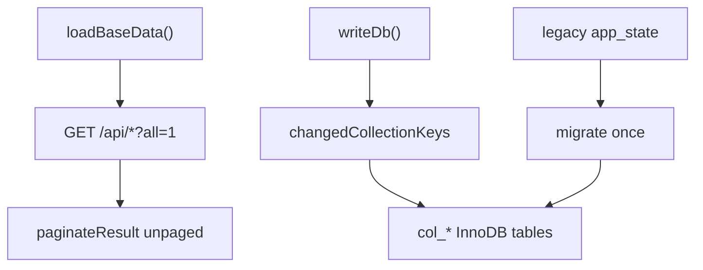

# MySQL Collection Storage

Feature Name: mysql-collection-storage
Updated: 2026-09-08

## Description

把基础数据加载改为 Unpaged Query，并把持久化从 `app_state` 整段 JSON 改为每个 Collection 一张 InnoDB 表、每条记录一行。

## Architecture

前端 `apiCollection()` 优先使用 `all=1`；若服务端仍分页，则按 `pageSize=100` 翻页合并。

后端 `writeDb()` 比较内存快照，只把脏集合写入对应 `col_*` 表。数组集合按记录 `id` 行存储；`systemConfig`、`runtimeState`、`topologyLayouts` 以 `__root__` 单行存储。

## Components and Interfaces

- `paginateResult(items, query)`: `all=1` 时返回 `{ data, total, totalPages: 1, all: true }`
- `collectionTableName(key)`: 将 `aiInspectionTasks` 映射为 `col_ai_inspection_tasks`
- `writeCollectionRows(connection, key, value)`: 批量 UPSERT 后删除过期 `batch_id`
- `migrateAppStateToCollectionTablesIfNeeded()`: 集合表为空时从 `app_state` 导入

## Data Models

`col_*` 表字段：`id VARCHAR(191) PK`、`payload LONGTEXT`、`batch_id BIGINT`、`updated_at TIMESTAMP`。

## Correctness Properties

- 分页接口默认行为保持 `pageSize` 最大 100
- Unpaged Query 仍走原有鉴权
- 迁移只在目标集合表为空时执行

## Error Handling

MySQL 不可用且 `ALLOW_FILE_DB_FALLBACK=true` 时回退 `data/db.json`。生产默认关闭回退，连接失败则抛错。

## Test Strategy

- regression: `pageSize=1` 只返回 1 条，`all=1` 返回全部且 `totalPages=1`
- 启动后创建项目/人员仍可被后续查询命中

## References

[^1]: (Filename) - server.js MySQL 集合表
[^2]: (Filename) - public/index.html apiCollection
