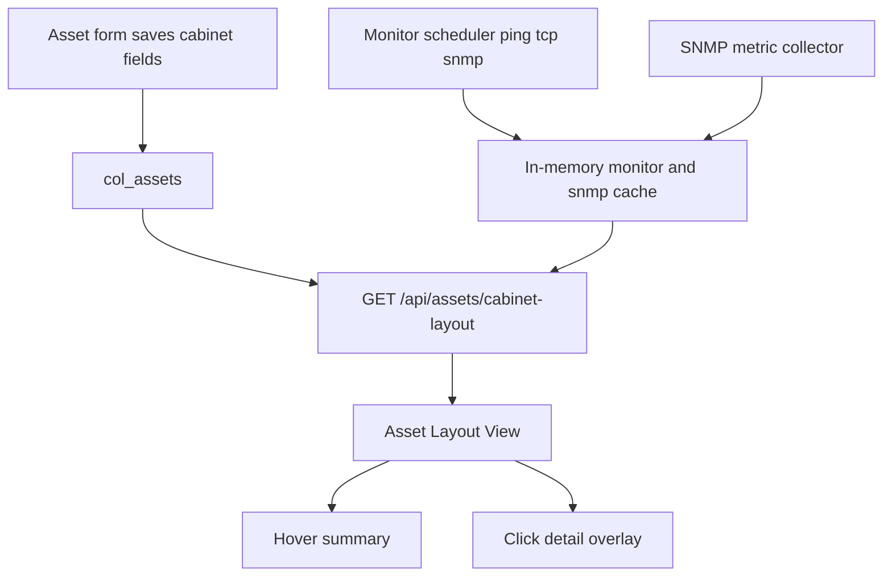

# Asset Cabinet Layout

Feature Name: asset-cabinet-layout
Updated: 2026-09-13

## Description

在「资产管理」二级菜单「资产拓扑」之后增加「资产布局图」。前端按机柜渲染 U 槽位；悬停显示摘要，点击打开 SNMP 实时详情。后端扩展资产机柜字段，并提供聚合布局接口与 SNMP 指标缓存。

## Architecture



布局页复用资产项目范围与客户脱敏。SNMP 采集在现有 `runAssetMonitorScheduler` 周期内对 `monitorType=snmp` 的资产追加指标抓取，结果只留内存缓存，不写入 MySQL。

## Components and Interfaces

- `server.js`
  - `normalizeDb` 为资产增加 `cabinetName`、`rackUnitStart`、`rackUnitSize`
  - `GET /api/assets/cabinet-layout`：按当前用户项目范围返回机柜分组、槽位冲突和监测/SNMP 快照
  - 资产 POST/PUT 接收并校验机柜字段
  - SNMP 采集：`sysUpTime`、HOST-RESOURCES 或 UCD-SNMP 的 CPU/内存/磁盘、IF-MIB 流量；失败字段留空
  - 客户响应删除 `monitorHost`、`snmpCommunity`，指标数值保留
- `public/index.html`
  - 「资产布局图」按钮放在「资产拓扑」之后
  - `viewerSubtabs.assets` 增加 `cabinetLayout`
  - 资产表单增加机柜名称、起始 U、占用 U
  - 机柜画布：每柜默认 42U，设备按起始 U 铺槽；悬停 300ms 摘要，点击详情浮层

## Data Models

```text
assets[] extra fields
  cabinetName     string   机柜名称，可空
  rackUnitStart   number   起始 U，1 到 48，可空
  rackUnitSize    number   占用 U 数，1 到 48，默认 1

GET /api/assets/cabinet-layout
  cabinets[]
    name          string
    unitCount     number
    devices[]
      assetId     string
      name        string
      type        string
      rackUnitStart number
      rackUnitSize  number
      conflict    boolean
      monitorStatus online | offline | unknown
      metrics
        uptimeSeconds   number | null
        cpuPercent      number | null
        memoryPercent   number | null
        diskPercent     number | null
        trafficInBps    number | null
        trafficOutBps   number | null
        collectedAt     string | null
  unassigned[]    same device shape
```

Excel 导入导出同步三列：机柜名称、起始U、占用U。

## Correctness Properties

- 非管理员只看到本项目资产
- 客户响应不含监测地址与 SNMP 团体字
- `rackUnitStart` 与 `rackUnitSize` 为正整数；超出 1-48 时接口返回 400
- 同一机柜 U 区间重叠时 `conflict=true`，两个设备都渲染
- 布局接口只读缓存，不在 GET 时对设备发起 SNMP

## Error Handling

- 未登录：401
- SNMP 超时或 MIB 缺失：对应 metric 为 null，前端显示「暂无数据」
- 无机柜资产：进入 `unassigned`
- 项目内无资产：前端显示「暂无资产」

## Test Strategy

- regression：带机柜字段创建资产后，`GET /api/assets/cabinet-layout` 出现在对应机柜
- regression：工程师只能看到本项目机柜
- regression：客户布局数据不含 `monitorHost` / `snmpCommunity`
- regression：Ping 监测资产的 CPU/内存/磁盘/流量为 null
- lint 通过

## References

[^1]: (Filename) - [Asset topology panel](public/index.html)
[^2]: (Filename) - [Asset monitor scheduler](server.js)
[^3]: (Filename) - [Requirements](.monkeycode/specs/2026-09-13-asset-cabinet-layout/requirements.md)
